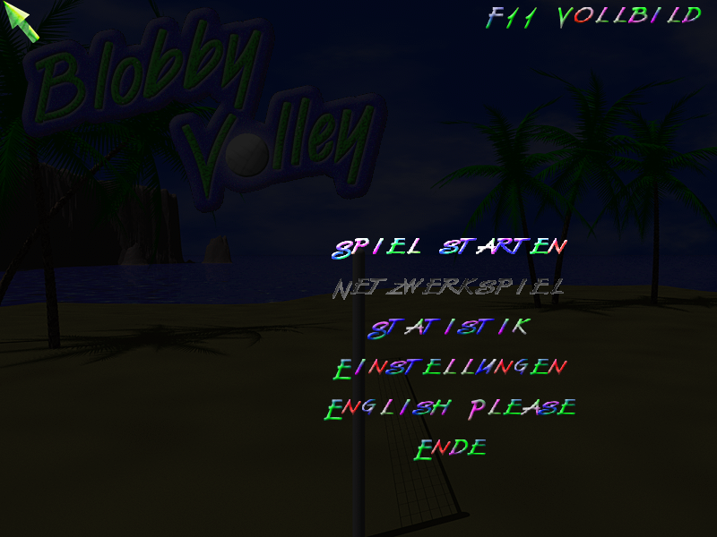
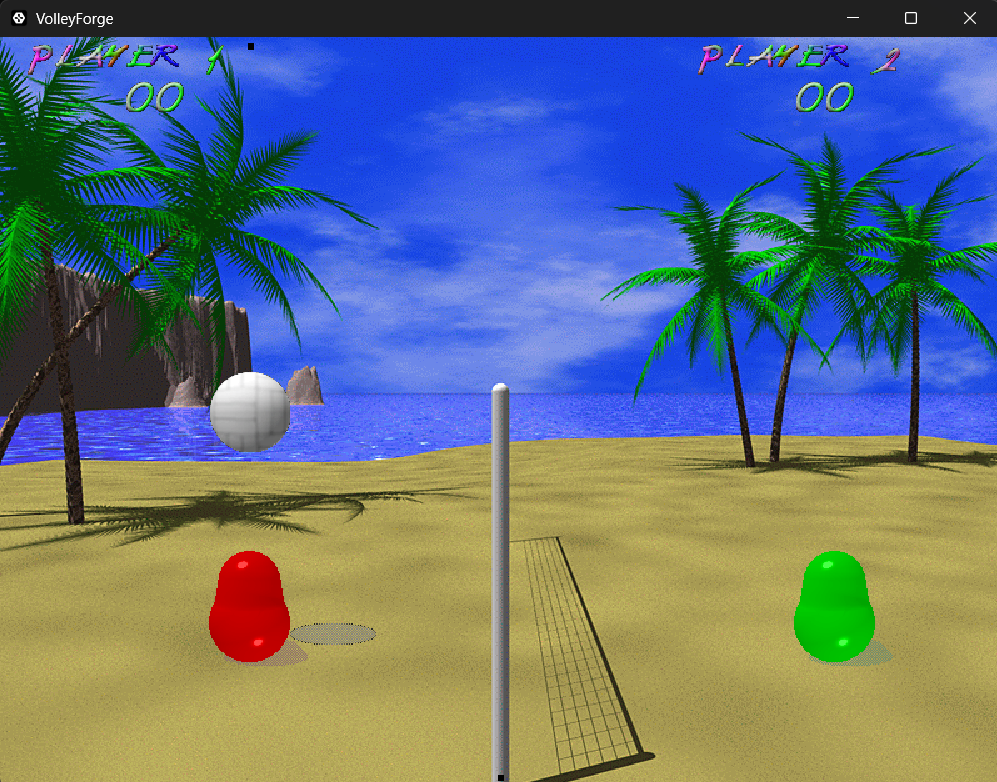

# 🏐 VolleyForge

<p align="center">
  🇩🇪 <a href="README.md">Deutsch</a> &nbsp;|&nbsp; 🇬🇧 <strong>English</strong>
</p>

> **The authentic 1-to-1 reimplementation of the classic *Blobby Volley* (2000/2001) in modern Rust.**  
> *The exact same feeling as back in childhood.*

<p align="center">
  <a href="https://skuldasbig.github.io/volleyforge/">
    <strong>🎮 Play directly in the browser (WebAssembly)</strong>
  </a>
</p>

<p align="center">
  
  
</p>

---

## 📖 About the Project

Anyone who visited a school computer lab around the turn of the millennium or spent afternoons at LAN parties knows it: **Blobby Volley**. Two gelatinous blobs, a volleyball, a beach, and countless thrilling duels against friends or the iconic AI bots *Adam*, *Bert*, and *Carl*.

**VolleyForge** is an independent, modern clean-room port of the original from 2000/2001 (version 1.7.4). The goal: **100% gameplay fidelity**. Every movement step, every collision with the net, the ball physics, the jump dynamics, color tints, and sound effects have been reconstructed pixel- and impulse-perfectly — without legacy Delphi / DirectX 7 dependencies, fluid and playable across platforms.

---

## 🔬 How was VolleyForge created?

VolleyForge is not a rough "by-eye" replica, but the result of genuine reverse engineering and reconstruction:

* 🔍 **Reverse Engineering:** The original `volley.exe` was analyzed using the **REA plugin** (*Reverse Engineer Anything*) driving **Ghidra**, deciphering physics, bitmaps, LZW containers, and constants directly from machine code.
* 🤖 **Iterative Pair Programming (definitely not a one-shot!):** The reimplementation was not produced by a magic button press, but through intensive, manually guided step-by-step collaboration with **MiniMax AI (M3.1 Flash)** — with lots of manual tuning, debugging, and polishing (after all, it's not Claude Opus :D).
* ☕ **The Fuel:** Countless cups of coffee, patience, and time to rebuild every single quirk and detail of the original pixel- and tick-accurate.

---

## ⚠️ Important: Original Assets & Copyright

Out of respect for copyright and to maintain clean-room integrity, this repository contains **no copyrighted original assets** (graphics, sounds, or text files). 

To play or build VolleyForge, the original asset containers are required:
- `graph.pak` (sprites, backgrounds, fonts, menu graphics)
- `sound.pak` (original sound effects)
- `text.pak` (localizations: German, English, French)

### 📥 Where can I get the original files?
The original game and its assets are preserved on [archive.org](https://archive.org/):
* ⬇️ **Direct Download:** [Download blobby.zip](https://archive.org/download/blobbyvolley_202102/blobby.zip) (~800 KB, contains `graph.pak`, `sound.pak`, `text.pak`)
* 🔗 **Archive Details Page:** [View Blobby Volley on Archive.org](https://archive.org/details/blobbyvolley_202102)

---

## 🚀 Getting Started / Setup

> 🌐 **Play directly in the browser:** Thanks to WebAssembly, you can play VolleyForge right in your web browser without installation:  
> 👉 **[https://skuldasbig.github.io/volleyforge/](https://skuldasbig.github.io/volleyforge/)**  
> *(On your first visit, simply drag & drop `blobby.zip` or the three `.pak` files into the browser window – done!)*  
>  
> 💡 **Desktop Downloads:** Under **Releases**, you'll find prebuilt binaries for all major platforms: **Windows** (x86_64, 32-bit x86, ARM64 as `.exe` & `.zip`), **macOS** (Universal `.dmg` & `.zip` for Apple Silicon & Intel), and **Linux** (`.AppImage` & `.tar.gz` for x86_64 and ARM64 / Raspberry Pi).

You can supply VolleyForge with the assets in one of two simple ways:

### Option A: Place containers alongside the executable (Recommended)
1. Download [blobby.zip](https://archive.org/download/blobbyvolley_202102/blobby.zip) from Archive.org and unpack the archive.
2. Copy the three files **`graph.pak`**, **`sound.pak`**, and **`text.pak`** **next to the executable**:
   ```text
   volleyforge/
   ├── volleyforge.exe
   ├── graph.pak
   ├── sound.pak
   ├── text.pak
   └── ...
   ```
   At startup, the game verifies that all three are present and unpacks them with a loading screen ("Initialization → Unpacking Graphics → Unpacking Fonts → Sounds → Texts"). If a file is missing, a message displays the expected directory — pressing <kbd>Enter</kbd> exits the game.
3. Launch the game (or run the compiled `volleyforge.exe`).

### Option B: Drop the VolleyForge executable into the original game folder
You can also drop the compiled **`volleyforge.exe`** directly into an unpacked folder of the original game (where the `.pak` files already exist) and launch it from there.

---

## 🎮 Controls

Controls match the original game precisely:

| Action | Player 1 | Player 2 |
| :--- | :--- | :--- |
| **Left** | <kbd>A</kbd> | <kbd>←</kbd> (Left arrow) |
| **Right** | <kbd>X</kbd> | <kbd>→</kbd> (Right arrow) |
| **Jump** | <kbd>C</kbd> | <kbd>↑</kbd> (Up arrow) |

### Mouse Control
* Target position: Horizontal mouse movement guides the blob.
* Jump: Click **left mouse button**.

### General Keys
* **<kbd>F11</kbd>**: Seamless toggle between windowed and fullscreen mode (includes a subtle hint in the main menu)
* **<kbd>ESC</kbd>**: Pause / Menu / Back

---

## 🌐 Network Multiplayer

> ⛔ **Desktop version only.** There are **no network matches in the web version** — web browsers cannot open raw UDP sockets. In the browser, the menu entry "NETWORK MATCH" remains grayed out, just like in the original without DirectPlay.

The original used **DirectPlay 4** back in 2001 — a library that is long gone. VolleyForge therefore speaks **raw UDP** and reproduces the original data packet **byte-for-byte**. Two machines in the same LAN are all you need.

### How It Works

**Host** — Main Menu → `NETWORK MATCH` → `HOST A GAME...`

| Row | Function |
|---|---|
| `GAME NAME:` | Name of the session. Left empty, the game assigns **"game N"** — exactly like the original. The name is preserved for the entire program runtime, even if the match is terminated in between. |
| `CONTROL:` | **KEYBOARD** or **MOUSE** for your own blob — switch with <kbd>Enter</kbd>. |
| `START GAME!` | Open the session and wait for the guest. |
| `BACK` | Return to the menu. |

**Guest** — Main Menu → `NETWORK MATCH` → `JOIN A GAME...`

| Row | Function |
|---|---|
| `HOST - IP:` | Host address, e.g. `192.168.1.20` or `192.168.1.20:24680`. If entered, it connects **directly** — without scanning. |
| `CONTROL:` | **KEYBOARD** or **MOUSE** for your own blob. |
| `SEARCH GAMES` | LAN broadcast: all waiting sessions appear in the list; select one of them. |
| `BACK` | Return to the menu. |

### Technical Details

* **Transport:** A single UDP socket on port **24680**. No external servers, no third-party software, no extra dependencies.
* **Packet:** **40 bytes** — 1 byte command, 3 bytes padding, 9 DWORDs. Commands **2 to 6 match the original**: 2 = score, 3 = state, 4 = input, 5 = sound, 6 = team color.
* **Faithful to the original:** The **host computes** ball physics and scores, sending the full game state every frame; the **guest mirrors** it and only transmits its own input (left/right/jump). This is a **state-sync**, not lockstep — exactly as in 2001.
* **Limitations:** LAN only (no NAT traversal across routers) and **desktop version only** — the web build cannot use UDP. On Windows, the firewall will prompt once to allow **UDP 24680**.

---

## ✨ Features

- 🏐 **Precise 1:1 Physics:** Exact ball integration, net collisions, sub-stepping, and authentic hitboxes.
- 🎨 **Original Canvas Pipeline:** 800×600 canvas, day/night mode for menus, and original color tinting.
- 🤖 **Iconic AI:** Full reimplementation of the opponents *Adam* (easy), *Bert* (medium), and *Carl* (hard).
- 🌐 **Network Play:** Faithful state-sync over raw UDP — 40-byte packets as in 2001, LAN broadcast session discovery, direct IP connection, zero external servers.
- 🔊 **Sound Support:** Authentic retro WAV playback via a lightweight, modern audio backend.
- 🖥️ **Modern Core:** Fast, clean Rust architecture with `egui` and OpenGL (`glow`), flexible windowed mode, or true fullscreen (<kbd>F11</kbd>) with crisp native scaling.
- 🛠️ **Built-in Diagnostics:** CLI commands for physics self-tests (`--selftest`), headless network testing (`--nettest`), and asset verification (`--dump-assets`).

---

## 🛠️ Building from Source

### Prerequisites
* [Rust](https://www.rust-lang.org/) (current stable version, 2024 edition)
* The 3 `.pak` files in the **repository root** (not checked into git — the build script copies them alongside the binary into `target/debug` or `target/release`)

### Build & Run
```bash
# Desktop version (Windows / Linux)
cargo run --release

# Web version (Run WebAssembly in browser)
cargo install trunk
trunk serve --release
```

> For copyright and clean-room reasons, the compiled `.wasm` module does **not** embed original assets.
> On the first run in the browser, players simply drag & drop the original `blobby.zip` (or the three `.pak` files)
> into the game window — the game decompresses them client-side in RAM and optionally stores them in `localStorage`.

---

## ⚖️ License & Legal Notice

VolleyForge is a pure fan and preservation project. It is not affiliated with, endorsed by, or associated with the original developers of *Blobby Volley* (Daniel S. / Silvio M.). All trademarks, assets, and references to the original game remain the property of their respective owners. The source code of VolleyForge was reconstructed independently through clean-room reverse engineering.
